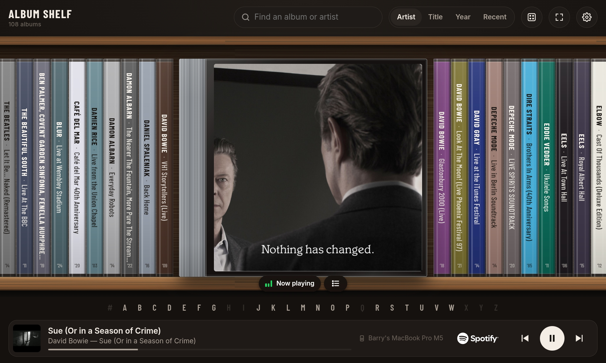
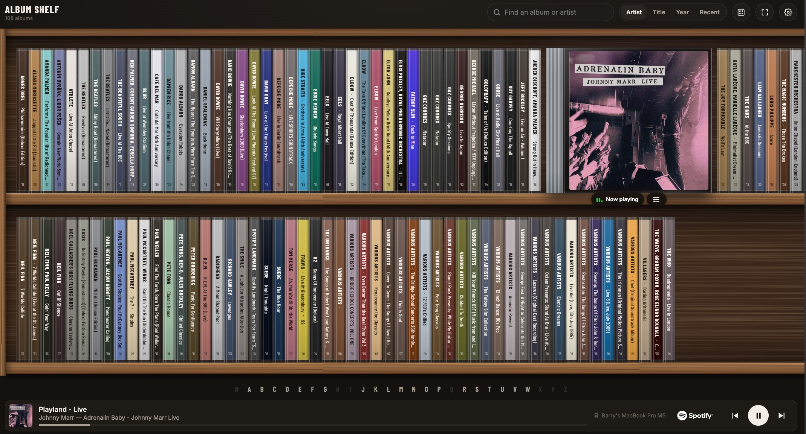
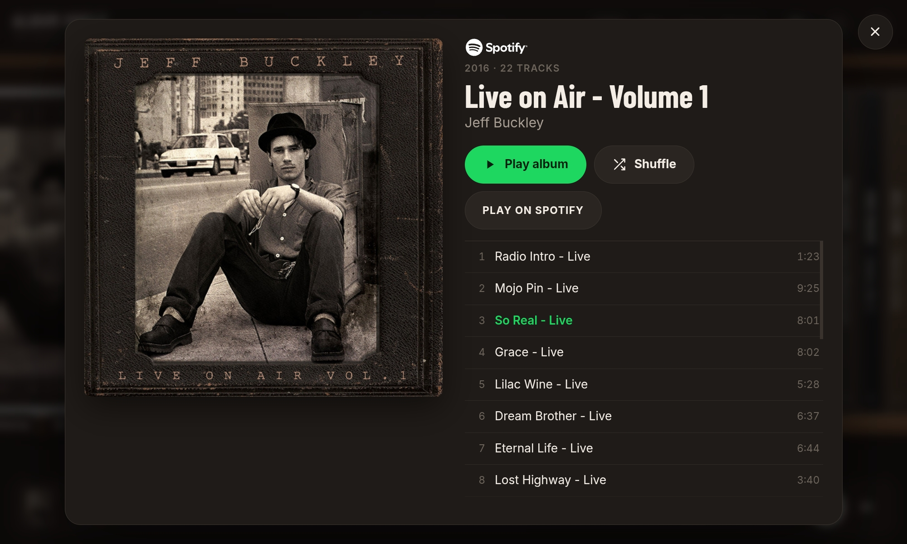
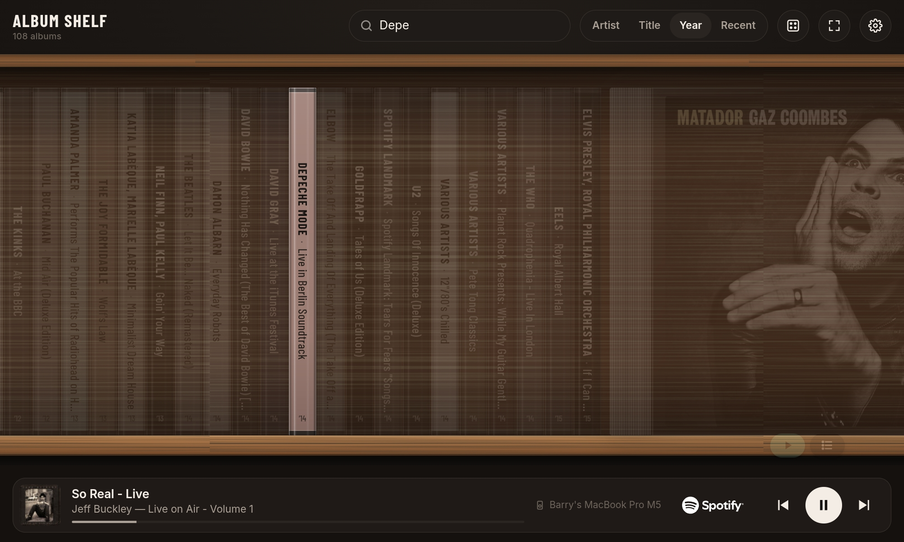

# Album Shelf (for Spotify)

A CD shelf for your Spotify library, built to run full-screen on a tablet or smartphone, but also works on laptops, PCs or any web browser.

Rediscover the joy of playing albums from start to end. Also great for curating music for parties or venues, only allowing people to pick from the albums saved in your Spotify account, not anything in the Spotify library.

Your saved Spotify albums sit on wooden shelves as CD spines, each coloured from its cover art. Tap a spine and it pulls out face-on with Play and Tracks buttons. The album that's playing turns face-out in the middle of the shelf, and the track list is one tap away. Playback goes through Spotify Connect, so the music comes out of whichever speaker, phone or tablet you pick.

**Open it here: https://bazzacollins.github.io/album-shelf-for-spotify/**

Tap **Try demo shelf** to see it without a Spotify account.

https://github.com/user-attachments/assets/f2a2085c-7ab2-4f07-be1f-bcc0c5764157

## Screenshots

**The album that's playing turns face-out** in its jewel case, in the middle of the shelf.



**Your whole collection at a glance.** Sort by artist, title, year or date added, and jump to any letter.



**Tap the playing album for its track list.** Play from any track, shuffle, or open the album in Spotify.



**Search as you type.** Everything else fades back so the matches stand out.



## What you need

- **Spotify Premium.** Spotify requires it for apps like this and for remote playback.
- **A free Spotify developer app of your own.** It takes a couple of minutes to set up, and it's what lets the shelf talk to your Spotify account. Spotify limits each developer app to five users, so everyone creates their own rather than sharing one.
- **A tablet or other device with a web browser.** Chrome on Android works well.

## Setup

1. **Create a Spotify app.** Sign in at [developer.spotify.com/dashboard](https://developer.spotify.com/dashboard) with your Spotify account, create an app, and tick **Web API**. The name and description can be anything.
2. **Add the redirect URI.** In the app's settings, add this to **Redirect URIs** exactly as shown, including the slash at the end, then save:
   ```
   https://bazzacollins.github.io/album-shelf-for-spotify/
   ```
3. **Connect.** Open the shelf, tap the settings (gear) button, paste your app's **Client ID**, and tap **Connect Spotify**. Spotify asks you to sign in and approve access, then sends you back to your shelf.
4. **Make it feel like a device.** On the tablet, open the shelf in Chrome, use **Add to Home screen**, and launch it from there. Use the full-screen button and, in settings, pick a default speaker.

If Spotify says your account isn't registered for the app, add your Spotify email under **User Management** in the developer dashboard.

## Good to know

- **Your Client ID stays with you.** It's stored only in your tablet's browser and never sent to anyone except Spotify.
- **Updates arrive automatically.** Improvements and fixes appear the next time the shelf loads, with nothing to install.
- **Sign-in lasts about six months.** Spotify expires sign-ins after that, so you'll need to tap **Connect Spotify** again roughly twice a year.
- **New albums appear automatically.** While the shelf is on screen it checks Spotify for added or removed albums every 15 minutes, and again when you come back to it. Use **Refresh albums** in settings to update it straight away.
- **Settings** cover how many shelves to show, what a tap on a spine does, the face-out cover, grey or clear CD cases, keeping the screen on, and fading the controls when idle.

## Privacy

Album Shelf runs entirely in your browser. It's a single static page with no server code, no analytics and no accounts. Your Spotify sign-in, album list and settings are stored only on the device you use it on, and are never sent anywhere except to Spotify. The person hosting the page never sees them. GitHub, which serves the page, sees ordinary web requests for it, as with any website.

**Sign out** in settings removes everything the shelf has stored. You can also remove its access from your Spotify account page under **Manage apps**.

## Licence

MIT — see [LICENSE](LICENSE). The licence covers Album Shelf's own code, not the Spotify logo.

The Spotify logo (`spotify-logo.svg`) is Spotify's official full logo from its [design guidelines](https://developer.spotify.com/documentation/design), included so the shelf can attribute Spotify as its developer rules require. Album Shelf isn't affiliated with or endorsed by Spotify. Spotify and the Spotify logo are trademarks of Spotify AB.
